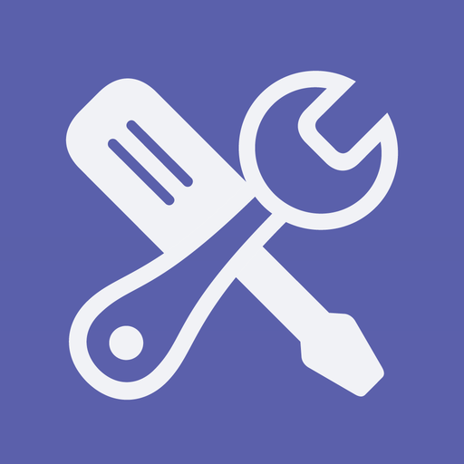

<p align="center">
  
</p>

<h1 align="center">Repair RSV</h1>

<p align="center">
  Free and open source Sony <code>.RSV</code> recovery for macOS.
</p>

Repair RSV is a macOS repair app and command-line recovery tool for Sony `.RSV` files left behind by interrupted recordings. It is built to make RSV recovery accessible without expensive proprietary repair services.

## What It Does

Sony cameras can leave behind `.RSV` files when recording is interrupted by power loss, card removal, crash, or similar failure. Those files can contain usable media data but lack the finished MP4 container structure.

Repair RSV uses a donor clip from the same camera/recording mode to rebuild a playable MP4 from the broken `.RSV`.

## What's Included

- `app`: macOS Tauri desktop app with drag/drop repair UI
- `bin/untrunc-rsv`: patched command-line recovery binary
- `lib`: bundled FFmpeg/Homebrew dylibs generated during release builds
- `source/untrunc-rsv`: full patched C++ source for the recovery engine
- `tests/rsv`: generated RSV recovery fixtures with byte-for-byte checks
- `scripts/recover-rsv.sh`: command-line wrapper for donor + broken RSV
- `scripts/build-from-source.sh`: rebuilds the patched recovery binary
- `scripts/tauri-bundle.sh`: builds/signs the app package
- `scripts/notarize-dmg.sh`: notarizes, staples, and validates the DMG

## Desktop App

The app is the easiest way to use the tool:

1. Open `Repair RSV`.
2. Drag in the broken `.RSV` file.
3. Drag in a donor video from the same camera/recording mode.
4. Click `Repair`.
5. Wait for progress to finish.
6. Reveal the repaired MP4.

The repaired file is written next to the broken `.RSV` with this suffix:

```text
_fixed-rsv.MP4
```

## Command-Line Use

Run the patched binary directly:

```zsh
./bin/untrunc-rsv -rsv "/path/to/donor.mp4" "/path/to/broken.RSV"
```

Or use the wrapper:

```zsh
./scripts/recover-rsv.sh "/path/to/donor.mp4" "/path/to/broken.RSV"
```

The donor clip should come from the same camera and recording mode as the broken RSV whenever possible.

## RSV Engine Changes

This project includes a patched build of `untrunc` focused on Sony RSV recovery.

The RSV recovery code:

- detects Sony `rtmd` GOP structure
- rebuilds video/audio sample tables from RSV data
- measures audio chunk size from the RSV itself, validating each GOP's video/audio boundary and taking the size most GOPs agree on
- handles incomplete trailing RSV GOPs without aborting with `Could not read chars`
- writes a repaired MP4 beside the broken RSV

The main engine source is:

```text
source/untrunc-rsv/src/mp4.cpp
```

## Development

Install dependencies:

```zsh
cd app
npm install
```

Run the app in development mode:

```zsh
npm run dev
```

Rebuild only the command-line recovery binary:

```zsh
./scripts/build-from-source.sh
```

Run the RSV recovery fixtures against a built engine (needs FFmpeg with `libx264` and `libx265`, and `python3`):

```zsh
./tests/rsv/run.sh bin/untrunc-rsv
```

The fixtures generate H.264 and HEVC clips with 4 × mono 24-bit and stereo 16-bit PCM, lay them out as Sony RSV GOPs, and recover them with the engine. Each recovery must match the source byte for byte per stream, with the same video packet sizes, keyframes, and stream durations.

Some fixtures plant audio that mimics a NAL unit at a GOP's video/audio boundary. Each one is built so that only one of the measurement's guards (whole-sample alignment, the NAL header check, or the GOP vote) can reject it, and the run checks how many GOPs agreed.

CI (`.github/workflows/ci.yml`) runs on every pull request and push to `main`: it builds the engine and runs these fixtures, and builds the web UI and checks the Tauri app on macOS.

## Release Build

The macOS release build:

- rebuilds `bin/untrunc-rsv`
- bundles required FFmpeg/Homebrew dylibs
- rewrites dylib install names to app-local `@loader_path` paths
- signs the helper and bundled dylibs
- builds the Tauri `.app`
- builds the signed DMG

Build the DMG:

```zsh
cd app
npm run bundle
```

Notarize, staple, and validate the DMG:

```zsh
npm run notarize
```

The DMG is written to:

```text
app/src-tauri/target/release/bundle/dmg/
```

## Signing And Notarization

This project is configured for macOS Developer ID distribution.

Expected local setup:

- Developer ID Application certificate installed in Keychain
- Apple notary credentials stored in Keychain profile `repair-rsv-notary`
- Xcode command line tools available

The app uses hardened runtime and an entitlement allowing the bundled repair helper to load its bundled FFmpeg dylibs.

## License

Repair RSV is licensed under GPL-3.0-or-later.

This project includes a modified build of `untrunc`, which is available under GPL-2.0-or-later, and this distribution uses GPL-3.0-or-later. The full corresponding source code and build scripts are included in this repository.

See `LICENSE` for the GPL text.

## No Warranty

This tool is provided without warranty. It may not recover every file. Always work from copies of damaged media when possible.
